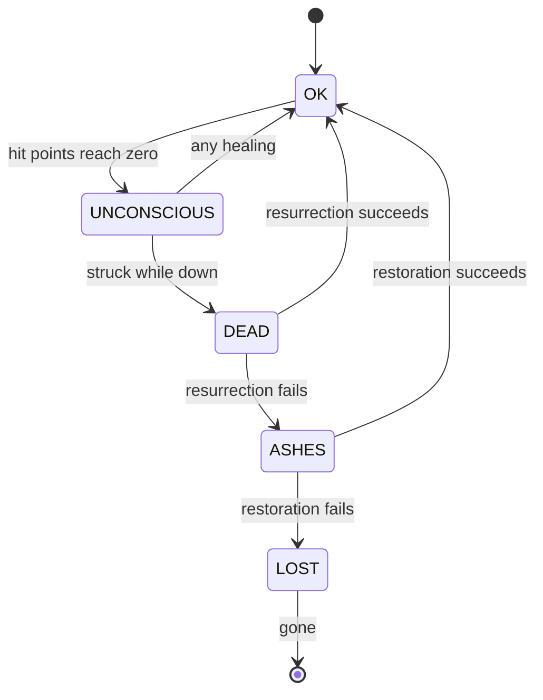

# The Party

## Context and Design Philosophy

The party is the thing the player actually owns. Characters, what they can do, and what
has happened to them all live here — and because both combat and exploration change
them, this segment is the only writer.

Three principles shape the design.

**One owner, many callers.** A potion drunk in a corridor and a mace swung in a fight
both change a character's hit points. Neither segment writes the field. Both call an
operation here, so the floor at zero, the death chain, and the four-member limit are
enforced in exactly one place, no matter what caused the change.

**Characters are what they have done.** Progression is not a number awarded for
surviving; it is a record of use. A character who has spent a campaign picking locks
is good at picking locks, and every skill advances at the same rate for everyone who
uses it. Class decides what a character may hold and cast, the body they start with,
and the one skill only their class can have — never how fast they learn.

**Advancement always costs something scarce.** In combat the clock is stopped, so
advancement is bounded by what the enemy was worth. Outside it the clock runs, so
training costs ticks, and ticks cost food. There is no action in the game
that improves a character for free, because an action that did would become the only
action worth taking.

## What This Segment Owns

| | Owned by the party | Owned elsewhere |
|---|---|---|
| Characters | attributes, skills, condition, class, total level | — |
| Classes | what a class is, and reading each from its authored file | content holds the files |
| Equipment | which item sits in which slot, and the pack the party carries the rest in | items define what an item *is*, and what moving one in or out of the pack means |
| The purse | how much gold the party carries, held for the party as a whole | loot decides how much a find adds |
| Skills | ranks, advancement, what is unlocked | combat resolves what an ability does |
| Condition | the state machine and its transitions | combat and exploration cause transitions |
| Attributes | the five scores | weapons decide which score they draw on |

## The Roster

A party holds at most four characters — as many as there are classes, so a second of
anything means going without something else. There is no seating: a character is in the party or
not, and combat reaches all four alike. What a party is made of is therefore a
question about classes, skills and equipment rather than about an arrangement, which is
the only kind of composition decision this game asks anyone to make.

## Attributes

Five scores, fixed at creation and moved only by rare effects.

| Attribute | What it contributes |
|---|---|
| **Might** | +4% damage per point over 10, for any weapon that names it |
| **Constitution** | hit points; resisting poison and disease |
| **Dexterity** | step cost, turn order, fleeing; +4% damage per point over 10 for a finesse weapon |
| **Intellect** | a mage's spell slots and spell magnitude |
| **Resolve** | a cleric's spell slots and spell magnitude; later, resisting fear and charm |

Each attribute has its own contribution rather than a blanket rule applied to whichever
one a weapon names. Might is the damage attribute by default, but *which* attribute a
weapon draws on for damage is a property of the weapon: a dagger with the *finesse*
property names Dexterity, and still trains Blade.

**Each casting class casts from its own attribute.** A class names the attribute its
magic draws on — Intellect for the mage's arcane schools, Resolve for the cleric's divine
ones — and that one attribute buys the caster's slots and grows their spells. Arcane
magic is study; divine magic is conviction. Splitting them gives each caster a score
that is theirs, and gives Resolve a job in every fight rather than only against effects
the game does not yet have.

There is no attribute for noticing things. Should finding hidden things ever enter the
game, it belongs to the Detection skill, which is practised and grows, rather than to a
score fixed at creation.

Attributes are fixed at creation and moved only by a trainer, rarely and at cost. They
are what a character *is*; skills are what they have done.

### Hit points

```
maximum hit points = class base × (1 + 0.05 × (Constitution − 10))
```

The base is authored in the class's file:

| Class | Base |
|---|---|
| Fighter | 30 |
| Cleric | 26 |
| Thief | 22 |
| Mage | 18 |

**Hit points never grow through play.** There are no character levels to grow them
with, and tying them to a skill rank would mean practising a weapon made a body harder
to kill. Getting harder to kill instead means better armour, better healing, spending
turns better, and — rarely — buying Constitution from a trainer.

This has a consequence worth being deliberate about: the survivability curve across a
campaign runs entirely through armour and healing, so enemy damage can stay
roughly flat as floors deepen instead of chasing an ever-growing pool. A deep floor
stays lethal to a veteran party in a way it would not if hit points had quietly
tripled on the way down.

Constitution is multiplicative rather than flat so that the classes stay distinct at
every score: a tough fighter gains more absolute hit points than a tough mage, and the
gap between the two holds at roughly 1.7× from Constitution 6 to 18.

## Skills

A skill is a named capability with a rank. Ranks unlock abilities: some active, some
passive. Skills are grouped for presentation only; nothing depends on the grouping.

| Group | Skills |
|---|---|
| Class | Ironclad, Backstab, Overchannel, Intercession — one per class, below |
| Weapon | Blade, Blunt, Polearm, Bow |
| Arcane | Evocation, Alteration |
| Divine | Healing, Restoration |
| Stealth | Detection, Disarm, Locks |
| Survival | Cartography, Cooking, Foraging |

**There are no armour skills.** Armour is gear: what a body wears and a shield in the
off hand turn a blow by a fixed amount, and practice does not change it. A skill for
wearing armour would have nothing to do — there are no penalties for it to reduce — and
being good at wearing armour is what the fighter's Ironclad is for.

Several of these are the missing owners of behaviour other segments already describe.
**Restoration**
owns resurrection, which the death chain below requires. **Detection** would own finding
hidden things, of which a floor holds none yet. **Cartography** owns mapping range, deferred in exploration since sight was
built.

The skill list itself is content data. Adding a skill is authoring, not designing.

### Total level

**Total level is the sum of a character's skill ranks.** It is derived, never stored and
never awarded: it moves when a rank moves and at no other time. It is computed the same
way for anything with ranks, so an enemy's level and a character's mean the same thing
and can be compared.

It is how much of a character there is, in one number. A character is otherwise a table
of ranks, which answers *what are they good at* and refuses to answer *how far along are
they* — a question that comes up whenever two characters, or a party and a floor, have
to be compared at a glance. Because it counts ranks rather than kills, a character who
has spent a campaign picking locks and a character who has spent it fighting can be the
same total level while sharing nothing, which is the honest answer in a game whose
progression is a record of use.

It confers nothing on its own. Nothing reads it to decide a roll, a reward, or what a
character may attempt; every such rule reads the ranks themselves, which is where the
meaning is. Total level is for showing, and for later systems that want one number to
weigh a party by.

### Advancement

Every enemy is worth a fixed amount of skill experience. When an encounter ends, that
amount is **divided equally among the distinct skills the party used during it** — not
weighted by how often each was used.

A skill counts as used whether or not it worked. A swing that missed and a spell that
was resisted both taught something; only never trying teaches nothing.

The pot **grows with the number of distinct skills used**, up to a ceiling, and is then
split equally. Growing it means a party is not punished for using its whole kit, which
a flat pot would do — five skills each taking a fifth would make the optimal play to
fight with one. The ceiling is what keeps the fight unfarmable: past a handful of
skills there is nothing further to gain, so a party cannot inflate the pot by dragging
a fight out long enough to cycle through everything it owns.

Twenty swings and one swing still earn the same, because the pot belongs to the enemy
rather than to the action. A specialist still advances faster in their specialty than a
dabbler does in any of theirs, because fewer skills divide their share.

Fighting things far below the party's level is not forbidden, only unrewarding: a weak
enemy carries a small pot, so farming decays on its own without a rule against it.
That leaves it available to a party that is underlevelled or rebuilding after a
disaster, which is when it should be available.

Outside combat a skill advances through use, bounded by the clock: cooking and
mapping both cost ticks, and ticks cost food.

**Every skill advances at the same rate for everyone.** There is no class multiplier and
no skill a class is barred from practising. What a character may *do* is bounded instead
by what their class may hold and cast: a fighter never trains Evocation because a
fighter never casts, not because a table forbids it. A mage who spends a campaign
swinging a mace gets as good with it as anyone who swung it as often. The one exception
is a class skill, which only its own class can hold at all.

#### What a rank costs

Ranks run from 1 to **10**, and each one costs more than the last:

```
experience to go from rank r to rank r + 1 = 300 × r
```

| From → to | Cost | Running total |
|---|---|---|
| 1 → 2 | 300 | 300 |
| 2 → 3 | 600 | 900 |
| 5 → 6 | 1,500 | 4,500 |
| 9 → 10 | 2,700 | 13,500 |

A rising cost is what makes farming decay on its own. A floor-one warband is worth
about 84 to the pot, which reaches a fighter's Blade whole when Blade is all they used —
some seven warbands for rank 2 → 3, and thirty-two for rank 9 → 10. The
same rank against floor-appropriate enemies costs seven or eight fights at any point in
the campaign, because the pot grows with the floor while the cost grows with the rank.
Early floors therefore stay *available* to a party that is underlevelled or rebuilding
after a disaster, and stay *slow* for one that is not, without a rule forbidding
anything.

**How far a skill is toward its next rank** is the share of that rank's cost its
experience has covered. It is reported here, beside the cost it is a share of, so that
nothing that shows it has to know the formula. A rank a class granted free is reported
as no progress until earned experience catches up with it, because that is how far the
holder actually is from the next one; a skill at the cap is reported as complete.

The cap of 10 is what lets content be calibrated at all: it fixes the top of the
damage curve, so the deepest floor can be built against a known ceiling
rather than an open-ended one.

## Class

A class is four things, and nothing else:

- **the body a character starts with** — the hit-point base Constitution is applied to;
- **what they may hold** — the item categories they may wield or wear;
- **what they may cast** — the schools of magic open to them, and the attribute their
  casting draws on;
- **the class skill** — one skill no other class can ever have.

It also sets which skills a fresh character opens with, so that nobody's first hour is
spent unable to do their job.

**A character's class is fixed for life.** It is chosen once, at creation, and nothing
changes it. A class skill belongs to the class, so a class that could change would
either strand that skill or hand it to a career it was never meant for.

### Where a class is written down

**Each class is one JSON file** under `src/game-data/classes`, and that file is the
whole of the class: every property listed above is in it and nowhere else. Reading one
file answers everything a class means. Nothing in code holds a class's numbers or lists,
and nothing branches on a class's name.

```json
{
  "id": "FIGHTER",
  "name": "Fighter",
  "hitPoints": 30,
  "classSkill": "IRONCLAD",
  "startingRanks": { "IRONCLAD": 1, "BLADE": 2, "BLUNT": 1, "POLEARM": 1 },
  "wields": ["LIGHT_WEAPON", "MARTIAL_BLADE", "MARTIAL_BLUNT", "LIGHT_ARMOUR", "HEAVY_ARMOUR", "SHIELD"],
  "schools": [],
  "castsWith": null
}
```

| Field | Means |
|---|---|
| `id`, `name` | identity |
| `hitPoints` | the hit-point base, before Constitution |
| `classSkill` | the class's own skill |
| `startingRanks` | the ranks a fresh character opens with, on top of the base skills every class shares; always includes the class skill at rank 1 |
| `wields` | the item categories this class may wield or wear; an item names its category |
| `schools` | the schools of magic whose spells this class may know and cast |
| `castsWith` | the attribute that buys this class's spell slots and grows its spells, or nothing for a class that does not cast |

The four classes as authored:

| | Fighter | Mage | Cleric | Thief |
|---|---|---|---|---|
| Hit points | 30 | 18 | 26 | 22 |
| Class skill | Ironclad | Overchannel | Intercession | Backstab |
| Starts with | Blade 2, Blunt 1, Polearm 1 | Evocation 2, Alteration 2, Blade 1 | Healing 2, Restoration 1, Blunt 1 | Detection 2, Disarm 2, Locks 2, Blade 1 |
| Wields | light and martial weapons, light and heavy armour, shields | light weapons, wands, light armour | light weapons, martial blunt weapons, wands, light and heavy armour, shields | light weapons, martial blades, light armour |
| Schools | — | Evocation, Alteration | Healing, Restoration | — |
| Casts with | — | Intellect | Resolve | — |

Permission to hold something flows through categories rather than item names, so that
content keeps flowing one way: a new weapon names its category and every class that
wields that category may hold it, without any class file being edited.

### Class skills

Each class has exactly one class skill, and **no other class can ever have it** — not
by practice, not from a tome, not authored onto a character of another class. A class
skill is otherwise an ordinary skill: it holds a rank from 1 to 10, costs the same to
advance, counts toward total level, and advances from the encounter pot when it was used
in a fight. Every class skill grows with its rank.

Enemies have no class, so no enemy holds a class skill.

#### Ironclad — Fighter

The fighter is the one the enemy hits, and the one built to take it.

```
armour            = worn armour × (1 + 0.05 × Ironclad rank)
weight as a target = 1 + 0.2 × Ironclad rank
```

At rank 1 armour turns a twentieth more and the fighter is 1.2 times as likely to be
picked as any other character; at rank 10, half again as much armour and three times as
likely. An enemy's choice of target is still a draw among every standing character —
Ironclad weights the draw, never decides it, so a fighter cannot make the rest of the
party untouchable.

Ironclad is used whenever an enemy attack strikes the fighter.

#### Backstab — Thief

The thief strikes before the enemy has found its feet.

```
damage multiplier = 1.9 + 0.1 × Backstab rank      (×2 at rank 1, ×2.9 at rank 10)
```

A thief's **weapon attack** on an enemy that has not yet acted in this fight multiplies
the attack's base damage, before armour is subtracted. Spells, items and anything else
are untouched. Once an enemy has taken its first action, Backstab no longer applies to
it. A fast thief — Dexterity fills the bar — reaches more enemies before they move,
which is the attribute and the skill pulling the same way.

Backstab is used whenever an attack it multiplies is made.

#### Overchannel — Mage

The mage can spend themselves when the slots run out.

```
hit points per spell rank = 7 − ⌈Overchannel rank ÷ 2⌉     (6 at rank 1, 2 at rank 10)
```

When a mage has no slot of a spell's rank left, they may still cast it by paying its
rank times that many hit points instead. The cost is paid, not dealt: it is not damage,
nothing reduces it, and it never knocks the mage out — a cast whose cost would bring the
mage to zero hit points or below is refused and costs nothing. Slots are always spent
first; Overchannel is only ever what happens after.

Magic stays attrition, because the hit points spent are the cleric's slots and the
party's potions spent later. What Overchannel adds is a choice at the bottom of the
slots: a mage with nothing left can still act like a mage, at a price the frailest body
in the party feels most.

Overchannel is used whenever a cast is paid for with hit points.

#### Intercession — Cleric

The cleric stands between a friend and the dark.

```
charges = 1 + ⌊Intercession rank ÷ 4⌋      (1 at ranks 1–3, 2 at 4–7, 3 at 8–10)
```

When damage would bring a conscious party member — the cleric included — to zero hit
points, and a conscious cleric in the party has a charge left, the member is left at
one hit point instead and the cleric spends a charge. It happens on its own: there is
no prompt and no turn spent. It catches only the fall into unconsciousness; damage to a
character already unconscious goes on through the condition chain untouched.

Charges are attrition like slots: spent charges are recorded on the cleric and restored
only by camping. With more than one cleric able to intercede, the first in the party's
order with a charge left spends one.

Intercession is used whenever it spends a charge.

## Condition

Five states, and the path between them runs one way under pressure and the other way
only at a cost.



An unconscious character is still in the party, taking no action, defending nothing,
and filling no readiness — there is nothing to move them out of, and nothing another
character can do for them but heal them. A dead one is carried. Each recovery costs
more than the last and can fail, and each failure degrades the character one step
further.

Transitions resolve one combatant at a time, as each comes ready, rather than in a
batch. A character at zero hit points who is struck before their healer's bar fills
goes down, and the healing that follows finds them unconscious. The readiness that
decides who acts first is combat's, and is recorded here only because the condition
chain is meaningless without it.

This is the steepest reading of *setbacks, not erasure*, and it is deliberately steep:
because skills are earned by use rather than bought with experience, a character who is
lost takes with them hours of specific, unrepeatable use. A party retreats from a bad
fight because of what it would cost to lose someone, not because of a number.

The tenet holds at the level it was written: a campaign cannot be erased, and a party
that loses a member rebuilds. One character is not everything.

## Party Operations

Every change to a character goes through an operation, and nothing outside this
segment writes a character field. The operations are few on purpose.

| Operation | Called by | Enforces |
|---|---|---|
| `applyDamage` | combat | the floor at zero, a cleric's Intercession, and the slide into unconsciousness or death |
| `payHitPoints` | magic, for an Overchannelled cast | that the cost is paid, not dealt — never reaching zero, never interceded, never a condition change |
| `applyHealing` | combat, exploration | the ceiling at maximum, and waking the unconscious |
| `attemptRevival` | camp, town, a hired cleric, a consumed scroll | the condition chain, and degrading on failure |
| `equip` | the player | slot rules, and that the item's category is one the class wields; the item comes from the pack and whatever it displaces goes there |
| `takeOff` | the player | the item goes to the pack |
| `stow` | loot, and the authoring of a starting pack | the item goes to the end of the pack |
| `addGold` | loot | gold is a count that only rises, never below zero |
| `useItem` | the player, out of a fight and in one | the item comes from the pack and is used up; it heals only the character using it, through `applyHealing`, and is refused, using nothing, for a character at full health or one who is not conscious |
| `awardEncounter` | combat | the pot divided equally among skills used |
| `trainSkill` | camp, exploration | the clock's cost, and that no class skill advances for a character of another class |
| `restoreCharges` | camp | every spent Intercession charge restored |

### Who can bring someone back

Restoration is a skill, but a party that lost its only Cleric must not be locked out of
recovery for the rest of the campaign. Four routes exist, and they are deliberately
redundant:

- a Cleric in the party, using Restoration
- a temple in town, for a fee
- a wandering cleric met in the dungeon, for a steeper fee
- a one-use scroll or relic, bought from a wandering merchant

The party's own Cleric is the cheapest and the only one available at depth without
luck. The rest are what stop a bad run becoming an unrecoverable spiral.

### Where a character is written down

The combatants a campaign starts with are **one JSON file each**, under
`src/game-data/players`, beside the enemies in `src/game-data/enemies`. A file holds
what a character is — name, class, attributes, ranks, attack, portrait, what they carry —
and nothing about where they came from. Hit points are not in it: a classed character
derives them from class and Constitution.

This segment defines the shape; the files are content and belong to nobody's code. A
party member and a goblin are authored the same way and read by the same loader, which
is what keeps them the same kind of thing.

### Starting ranks

No skill begins at zero that a character is expected to use. Every class starts with a
set of **base skills at rank 1** that all classes share, plus its own set at rank 1 or
higher. A fresh Thief can already detect something; a fresh Cleric can already attempt
a revival. A generator that produced a party unable to play its first hour would have
failed.

### Using an item

A consumable is used by the character whose turn or Items page it is, and it heals that
character and nobody else. A potion is drunk, and drinking needs a character who is
awake: an unconscious one can't, and the dead can't at all. Waking someone is healing
magic's job.

A refused use changes nothing. The potion stays in the pack and no tick or turn is
charged, because the player is told no before anything moves, as with a refused equip.

## Persistence

The whole roster is saved: every character's attributes, skills and ranks, condition,
equipment slots, class, accumulated skill experience and spent Intercession charges,
with the pack and the purse. A class is saved by its id; what the class means is read
from its file, never from the save. A lost character is
kept in the save as a record rather than deleted, because a campaign should be able to
show what it cost.

## Decisions & Alternatives

| Decision | Chosen | Alternatives Considered | Rationale |
|---|---|---|---|
| Hit-point growth | None: class base and Constitution, fixed for life | Growth with the best armour skill rank; a Toughness skill trained by being hit; character levels | Every growth mechanism needs enemy damage to grow alongside it, and a campaign that inflates both ends changes nothing except the size of the numbers. Fixed hit points keep a deep floor genuinely lethal to a veteran, and route survivability through armour and healing, which are decisions made in the fight. |
| Total level | The sum of skill ranks, derived on demand | A level awarded for experience, with ranks bought from it; a stored number kept in step with the ranks | A character is their ranks; any number claiming to summarise them should be recomputable from them, or it is a second truth to keep in step and eventually to contradict them. An awarded level would also be a second progression track competing with the one the whole segment is built on. |
| Constitution's shape | Multiplicative, 5% per point over 10 | Flat hit points per point | Flat would make a point of Constitution worth the same to a mage as to a fighter, compressing the classes together at high scores until a tough mage outlasts a frail fighter. |
| Rank cost | 300 × r to leave rank r, capped at rank 10 | A flat cost per rank; a geometric curve | A flat cost makes floor one exactly as efficient at rank 9 as at rank 2, so nothing ever pulls a party downward. A geometric curve makes the last ranks a grind measured in hundreds of fights. A linear-cost curve decays farming gently while leaving it available. |
| Rank ceiling | 10 | Uncapped ranks | Without a ceiling there is no top to the damage curve, and the deepest floor cannot be built against anything. |
| Who writes character state | Only this segment, through named operations | Combat and exploration writing fields directly | Both legitimately change hit points. One owner means the zero floor, the death chain and the roster limits are enforced once rather than in every caller. |
| Progression | Skill ranks earned by use | Experience points and character levels | A character should be what they have done. |
| Training speed | One rate for every skill and every class; nothing a class cannot practise | A rate multiplier per class per skill, and a set each class cannot train | A rate table made class a second, invisible progression system, and its only real effect was the yes/no of which skills a class could train. What a class may hold and cast already bounds what it practises, so the table bought nothing that wielding and schools do not. |
| Where a class is defined | One JSON file per class holding every property of it | A table in code; properties spread across item and spell files naming their classes | A class should be readable in one place. A table in code puts authoring inside a programming language, and lists on items and spells mean no single file says what a fighter is. |
| What a class may hold | Item categories, listed by the class and named by the item | Items listing their classes; classes listing item ids | Categories keep content flowing one way — a new weapon names a category and edits no class — while letting the class file state its permissions whole. A list of item ids would need every class edited for every find. |
| Class change | None: class is fixed at creation | Changing class at a trainer, keeping ranks | A class skill belongs to its class. Changing class would either strand a skill the character can no longer use or carry it into a class it was never meant for. |
| A class skill | One per class, unique to it, ranked and advanced like any skill | Several per class; abilities with no rank; class skills learnable by others from tomes | One is enough to make each class plain at a glance. Ranking it like any skill keeps one progression system. Exclusivity is what makes it the class's identity rather than a head start. |
| Armour skills | None; armour is gear | Heavy Armour, Light Armour and Shield as skills raising armour by rank | With no penalty for wearing armour there is nothing for a skill to reduce, and raising armour by rank would make every class tank alike. Ironclad gives that axis to the one class it belongs to. |
| Spell attribute | Named by the class: Intellect for the mage, Resolve for the cleric | Intellect for every caster | One attribute for every caster leaves the cleric with a score that does nothing and Resolve with nothing to do. |
| Ironclad's draw on enemies | A weight on the target draw | Enemies always attacking the fighter; a taunt action | A weight protects without deciding. A guaranteed target would make the rest of the party untouchable and every fight the same fight. |
| Intercession's trigger | Automatic, on the fall into unconsciousness, from charges restored at camp | A prompt the player answers; per fight; also catching death | A prompt would stop the fight at the worst moment for a choice with one answer. Per fight makes it free; charges make it attrition like slots. Catching only the first fall keeps death a real threat. |
| Overchannel's cost | Hit points per spell rank, falling with rank, never to zero | A chance of failure; a cost in readiness | A fixed cost keeps the preview honest. Hit points are the scarcest thing a mage has, which makes the choice real, and refusing a cast that would knock the caster out keeps the cost a price rather than a trap. |
| Combat advancement | A pot per enemy, growing with distinct skills used up to a ceiling, split equally | Per-action gain; a flat pot split equally; diminishing returns per action | A pot fixed by the enemy is what makes prolonging a fight worthless. Growing it with distinct skills stops a flat split punishing a party for using its whole kit; the ceiling stops a party inflating it by dragging the fight out until everyone has touched everything. |
| A missed attack | Counts as use of the skill | Only successful use counting | Trying and failing is how anyone learns. Requiring success would also make advancement fastest against the weakest enemies, which is the opposite of what the pot is for. |
| Starting ranks | Shared base skills at rank 1, plus class skills at rank 1 or better | Everything beginning at zero | A party that cannot detect, heal or fight on its first descent has no first hour. |
| Reviving without a Cleric | Town temples, wandering clerics, and one-use scrolls | Restoration being the only route | Losing the only Cleric would otherwise spiral into an unrecoverable campaign, which the tenet forbids at the campaign level. |
| An unconscious character | Stays where they are; only healing changes anything | Swapping them out of a front rank for an action, as a positional combat would need | With no positions in a fight there is nowhere to move a body to and nothing exposure could mean. Going down costs the party that character's turns until somebody spends one reviving them, which is the whole of the cost and needs no rule of its own. |
| Low-level farming | Allowed, and unrewarding on its own terms | Forbidding it with a level cutoff | A small pot is its own disincentive, and the option should stay open to a party rebuilding after a disaster — which is exactly when a cutoff would bite hardest. |
| Attributes and skills | Deliberately unbound; weapons declare what they draw on, classes what they cast with | Each skill governed by a fixed attribute | Binding them flattens the difference between a dagger and a mace. A finesse weapon drawing on Dexterity while still using Blade is the kind of nuance that makes equipment interesting. |
| Death chain | Unconscious, dead, ashes, lost, with failure degrading | Always-recoverable death; a chain with no final stage | Skills earned by use make a loss unbuyable, so the threat has real weight. The tenet holds at the campaign level: losing a character is a setback, not erasure. |
| A lost character | Kept in the save as a record | Deleted from the roster | A campaign should be able to show what it cost. |
| Gold | One purse for the party | A purse per character | The same argument as the shared pack: splitting it makes the player track who carries what, for no decision. |
| Who a potion heals | Only the character using it, who must be conscious | Any character, including the unconscious | A potion is drunk. Tending someone else, and waking the unconscious, is what healing magic is for, which keeps that a reason to bring a cleric. |

## Open Questions & Future Decisions

### Resolved

1. ✅ **This segment is the only writer** of character state; everyone else calls an operation.
2. ✅ **At most four characters**, as many as there are classes, with no seating among them.
3. ✅ **Progression is skill rank earned by use**, not experience and levels.
4. ✅ **Total level is the sum of a character's skill ranks**, derived rather than stored, and confers nothing by itself.
5. ✅ **An enemy carries a pot** that grows with the distinct skills used against it up to a ceiling, then divides equally.
6. ✅ **A miss counts as use.** Trying and failing still teaches.
7. ✅ **A rank costs 300 × r to leave rank r**, and ranks cap at 10.
8. ✅ **Class sets starting ranks**: shared base skills at 1, plus its own at 1 or higher.
9. ✅ **Class governs what a character may hold and cast**, never how fast they learn; every skill advances at one rate.
10. ✅ **Attributes are not bound to skills**; weapons declare which attribute they draw on, and classes which one they cast with.
11. ✅ **Hit points never grow through play** — class base and Constitution, fixed for life.
12. ✅ **The death chain degrades on failed recovery**, and a character can be lost.
13. ✅ **An unconscious character stays where they are**; with no positions there is nothing to move them out of.
14. ✅ **Revival has four routes** — party Cleric, town temple, wandering cleric, one-use scroll.
15. ✅ **A lost character stays in the save** as a record.
16. ✅ **The party shares one purse**, beside the pack.
17. ✅ **A consumable heals only whoever uses it**, and only while they are conscious.
18. ✅ **Each class is one JSON file** holding every property of the class, and nothing in code holds a class's numbers.
19. ✅ **Class is fixed for life**; nothing changes it.
20. ✅ **Each class has one class skill** no other class can ever hold: Ironclad, Backstab, Overchannel, Intercession.
21. ✅ **There are no armour skills**; armour is gear.
22. ✅ **A caster casts from the attribute their class names**: Intellect for the mage, Resolve for the cleric.

### Deferred

1. **Ability definitions.** Ranks unlock abilities, and what an ability *does* is combat's to resolve — but no ability is authored. The unlock mechanism is designed; the abilities are not.
2. **Class skill tuning.** The four class skills' formulas are first numbers, untuned against play.
3. **Enemy pot values.** What an enemy is worth belongs with enemies, which authors it per roster entry. Only the first floor's roster is written.
4. **Character creation.** How attributes are set at the start — rolled, allocated, or fixed by class — is unspecified.
5. **The pot ceiling.** That the pot stops growing past a handful of distinct skills is settled; where the ceiling sits is content data and untuned.
6. **Trainers and towns.** Buying attributes needs a place to happen; no town segment exists.
7. **Carrying the dead.** A dead character is carried, but whether that costs the party anything — weight, speed, morale — is unaddressed.

## References

- `docs/high-level-design.md` — the four-member party and *setbacks, not erasure*.
- `docs/intent/exploration/exploration-design.md` — the operations exploration calls, and the skills that own its deferred behaviour.
